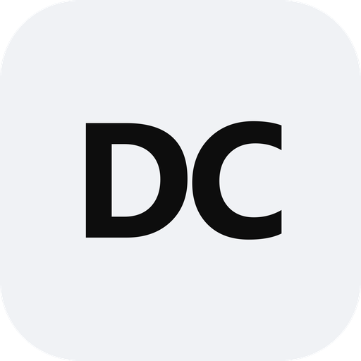

<h1 align="center">
  
   
  DedsiClash
</h1>

基于 Clash Verge Rev 的 UI 定制分支。

## 项目说明

**DedsiClash** 是从 [Clash Verge Rev](https://github.com/clash-verge-rev/clash-verge-rev) fork 而来的项目，主要根据个人使用习惯调整 UI、布局和应用图标。

本项目的核心代理功能沿用上游实现，修改以界面与品牌定制为主。为适配 DedsiClash 这一独立应用名称，也调整了应用标识及安装打包配置。

如果你希望使用原版、了解完整功能或查看官方文档，请访问上游项目：

- [Clash Verge Rev 原项目](https://github.com/clash-verge-rev/clash-verge-rev)
- [上游使用文档](https://clash-verge-rev.github.io/)
- [上游版本下载](https://github.com/clash-verge-rev/clash-verge-rev/releases)

## 主要调整

- 应用名称统一为 **DedsiClash**。
- 调整浅色界面、侧栏导航及页面布局。
- 使用自定义透明 DC Logo，统一应用、桌面及系统托盘图标。

## 开发与构建

环境准备与构建方式请参阅 [CONTRIBUTING.md](./CONTRIBUTING.md)。

## 致谢

感谢 [Clash Verge Rev](https://github.com/clash-verge-rev/clash-verge-rev)、[Clash Verge](https://github.com/zzzgydi/clash-verge)、[Mihomo](https://github.com/MetaCubeX/mihomo)、[Tauri](https://github.com/tauri-apps/tauri) 及所有上游贡献者。

DedsiClash 是独立维护的 fork，不代表上游项目。

## 许可证

本项目遵循 **GPL-3.0-only** 许可证，详见 [LICENSE](./LICENSE)。原项目及第三方代码的版权与许可证声明继续保留。
