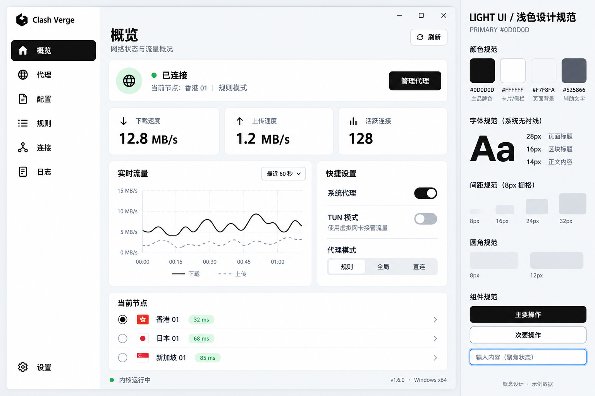

# Light UI Guidelines

This specification defines the agreed light visual direction for the desktop
application: white surfaces, a pale gray canvas, and `#0D0D0D` as the primary
color for text, actions, and selection. It is a design reference for subsequent
UI work, not a description of the currently implemented theme.

The values below are project design decisions. Accessibility requirements refer
to WCAG 2.2 AA; adopting this palette alone does not establish compliance.

## Visual reference

The concept illustrates navigation, connection status, traffic metrics, charts,
quick settings, and node selection. Image text, branding, versions, navigation
order, and data are illustrative. Use the written tokens and component rules
below for implementation, and retain the application's actual branding,
localized labels, available features, and data.

## Color tokens

| Token | Value | Application |
| --- | --- | --- |
| `primary` | `#0D0D0D` | Primary actions, selected navigation, active switches |
| `primaryHover` | `#262626` | Primary action hover |
| `primaryPressed` | `#000000` | Primary action pressed |
| `onPrimary` | `#FFFFFF` | Text and icons on primary surfaces |
| `background` | `#F7F8FA` | Page canvas |
| `surface` | `#FFFFFF` | Sidebar, cards, menus, dialogs |
| `surfaceMuted` | `#F0F2F5` | Secondary surfaces, segmented control tracks |
| `surfaceHover` | `#F0F2F5` | Neutral row and secondary action hover |
| `surfacePressed` | `#E5E7EB` | Neutral row and secondary action pressed |
| `textPrimary` | `#0D0D0D` | Titles, body text, values |
| `textSecondary` | `#525866` | Descriptions, units, supporting information |
| `divider` | `#E5E7EB` | Decorative separators and card borders |
| `controlBorder` | `#858B95` | Input boundaries and unselected radio outlines |
| `focus` | `#2563EB` | Keyboard focus ring |
| `success` | `#15803D` | Connected and healthy states |
| `successSurface` | `#DCFCE7` | Success badge background |
| `warning` | `#B45309` | Warnings requiring attention |
| `warningSurface` | `#FEF3C7` | Warning badge background |
| `error` | `#B91C1C` | Errors and destructive actions |
| `errorSurface` | `#FEE2E2` | Error badge background |
| `disabledSurface` | `#F0F2F5` | Disabled controls |
| `disabledText` | `#858B95` | Disabled labels and icons |

Keep large surfaces light. Concentrate black on important content and controls;
use semantic colors in small areas that communicate status. Blue is reserved
for focus and informational meaning rather than the default primary action.
Pair status colors with text or symbols. Disabled styling is only for genuinely
unavailable controls; required explanations use readable secondary text.

Decorative dividers must not be the sole visible boundary of an input. Use
`controlBorder` when a boundary is needed to identify an interactive control.

## Typography

Use platform system fonts without adding a font dependency. Prefer Segoe UI and
Microsoft YaHei UI on Windows, and system UI and PingFang SC on macOS. Preserve
appropriate fallbacks for other supported systems, scripts, and emoji.

| Role | Font size | Line height | Weight |
| --- | --- | --- | --- |
| Page title | 28px | 36px | 600 |
| Primary metric | 32px | 40px | 600 |
| Section title | 16px | 24px | 600 |
| Body | 14px | 22px | 400 |
| Control label | 14px | 22px | 500 |
| Supporting metadata | 12px | 18px | 400 |

Use 14px for information needed to complete a task. Reserve 12px for metadata.
Use tabular numerals for changing metrics and aligned numeric columns, and
separate values from units, such as `12.8 MB/s` and `32 ms`. Let translated
labels wrap or expand without clipping controls.

## Layout and spacing

All measurements are CSS pixels. Use an 8px spacing grid with 8, 16, 24, 32,
and 48px steps; 4px is available for small icon-to-label and badge gaps.

| Element | Default |
| --- | --- |
| Sidebar width | 208px |
| Main content padding | 24px |
| Card gap | 16px |
| Card padding | 24px |
| Navigation item height | 44px minimum |
| Standard control height | 40px minimum |
| Standard list row height | 48px minimum |
| Standard icon | 20px |
| Card and dialog radius | 12px |
| Button and input radius | 8px |
| Border width | 1px |

Use minimum heights rather than fixed heights where text can wrap. In wide
windows, arrange related content in two columns; in narrow windows, stack it
in reading order. Choose the transition from actual content fit rather than
shrinking labels or controls. Keep navigation accessible at the supported
minimum window size. Data tables may scroll horizontally inside their own
region when their relationships require a two-dimensional layout.

Use whitespace and borders to separate ordinary cards. Menus and dialogs may
use a restrained shadow, such as `0 8px 24px rgb(13 13 13 / 10%)`. Avoid
decorative gradients, heavy shadows, and glass effects in this direction.

## Component behavior

### Buttons

Primary buttons use `primary` with `onPrimary`; secondary buttons use a white
surface, dark text, and a visible border. Use 16px horizontal padding and an 8px
icon-to-label gap. Each action area should have one visually dominant action.
Use the error color for destructive intent and explain irreversible effects.

Primary hover and pressed states use their respective tokens. Neutral actions
use `surfaceHover` and `surfacePressed`. Loading actions retain their label and
size, communicate progress, and prevent duplicate submissions. Icon buttons
have an accessible name, a tooltip where useful, and a 40px interaction area.

### Inputs and selectors

Place a persistent label above or beside each field. Placeholder text may show
an example but must not replace the label. Use 12px horizontal padding, a 40px
minimum height, and `controlBorder` at rest. Hover may darken the boundary to
`textSecondary`; focus adds the focus ring. An invalid field uses an error
boundary and an adjacent explanation associated with the field.

Preserve entered values on validation or submission failure. Provide a clear
recovery action. Use existing select and combobox behavior for keyboard access.

### Navigation and selection

Selected sidebar items use a black background and white text and icons.
Unselected items use dark content on white, with a pale gray hover surface.
Expose the current destination programmatically. Keep focus distinct from
selection so keyboard users can identify both.

Segmented controls use a muted track and a white selected segment with dark
text. Radio controls use an outline plus an inner mark for selection. Selected
rows also expose their selected state to assistive technology.

### Switches and settings

Enabled switches use a black track with a white thumb; disabled settings use a
neutral track. Thumb position must distinguish on from off without color.
Every switch has a persistent label and exposes its checked state. Explanatory
text belongs directly below the setting label when needed.

During asynchronous changes, communicate that the setting is being applied.
If the change fails, restore or display the actual effective state and explain
the failure. Do not report a successful network change before it completes.

### Lists and data displays

Left-align names and descriptions; right-align comparable numeric values.
Retain enough room for localized labels and units. Truncate long identifiers
only when the full value remains available through an accessible disclosure.
Use real interactive elements for row actions and avoid nested click targets.

Charts need labeled units, a readable legend, and distinguishable line styles
or markers. Use a solid dark line for download and a dashed secondary line for
upload in the traffic chart. Provide current values or a textual alternative
for important chart information. Keep live values stable in width and avoid
announcing every refresh to screen readers.

### Feedback and dialogs

Show loading, empty, disconnected, and failure states in the relevant content
area. Empty states explain what is missing and offer an applicable next action.
An unavailable metric must not appear as a measured zero. Keep persistent
failures near the affected content; transient success feedback may use a toast.

Dialogs have a clear title and explicit actions. Move focus inside on opening,
contain keyboard focus while modal, and restore focus on closing. Support
Escape when dismissal is safe. Keep native window controls and draggable areas
usable; draggable regions must not interfere with content interaction.

## Motion and keyboard focus

Use 120–200ms transitions for hover, selection, and small state changes.
Respect `prefers-reduced-motion`; remove nonessential motion and avoid scaling
or animating the entire application during routine navigation.

Use a visible 2px `focus` outline with a 2px offset for keyboard focus, with
equivalent treatment for controls that need an inset indicator. Ensure focus
is not clipped or obscured by scrolling containers, sticky regions, or dialogs.
Maintain logical Tab order and use standard keyboard behavior for each widget.

## Accessibility baseline

Normal text needs a contrast ratio of at least 4.5:1. Large text needs at least
3:1; WCAG defines large text as at least 18pt regular or 14pt bold, approximately
24px regular or 18.7px bold. Necessary control indicators and graphical objects
need at least 3:1 against adjacent colors under the applicable criterion.
Evaluate actual foreground and background combinations, including interaction
states, rather than relying on individual token values.

This design uses 40–44px targets for ordinary controls. WCAG 2.2 AA requires
24 by 24 CSS pixels for pointer targets, subject to its specified exceptions;
larger project defaults improve usability. Preserve usable content with text
enlargement and zoom, accessible names for controls, associated field errors,
and status information that does not rely on color alone.

References:

- [WCAG 2.2](https://www.w3.org/TR/WCAG22/)
- [Text contrast](https://www.w3.org/WAI/WCAG22/Understanding/contrast-minimum.html)
- [Non-text contrast](https://www.w3.org/WAI/WCAG22/Understanding/non-text-contrast.html)
- [Target size](https://www.w3.org/WAI/WCAG22/Understanding/target-size-minimum.html)
- [Visible focus](https://www.w3.org/WAI/WCAG22/Understanding/focus-visible.html)

## Implementation in this repository

Use the existing React and Material UI theme and components. The current light
theme defaults are in `src/pages/_theme.tsx`; theme construction and user theme
settings are handled in `src/pages/_layout/hooks/use-custom-theme.ts`. Inspect
these entry points and applicable repository instructions before implementing.

Centralize shared colors, typography, spacing, and component states through
the existing theme rather than scattering literal values across pages. The
token names above describe design roles and do not require renaming existing
configuration keys or introducing a new styling system.

Use light mode exclusively; do not offer theme-mode switching or follow system
appearance. Preserve user theme customization, localization, and existing
functional behavior outside theme-mode selection.
Reuse installed icons and components; this design does not require new
dependencies, new product features, or the exact screen composition in the
concept image. Follow the repository's issue-first requirement for non-trivial
implementation changes.
